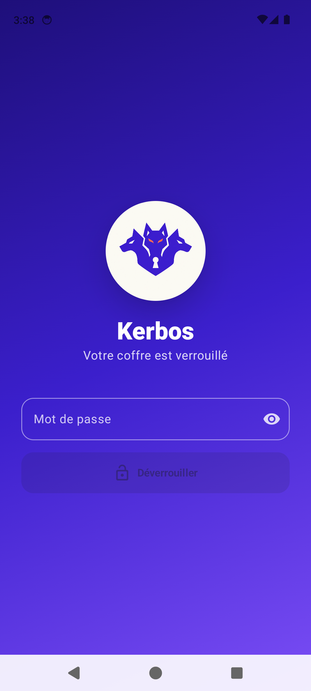
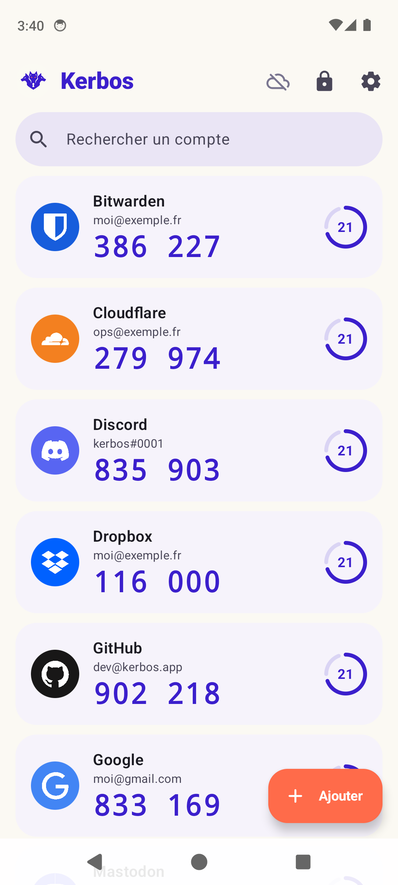
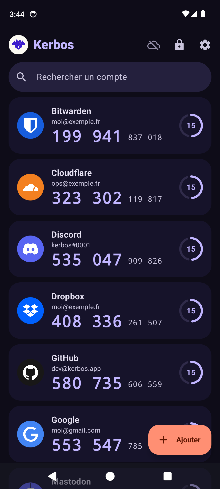
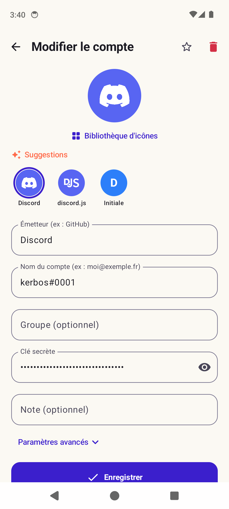
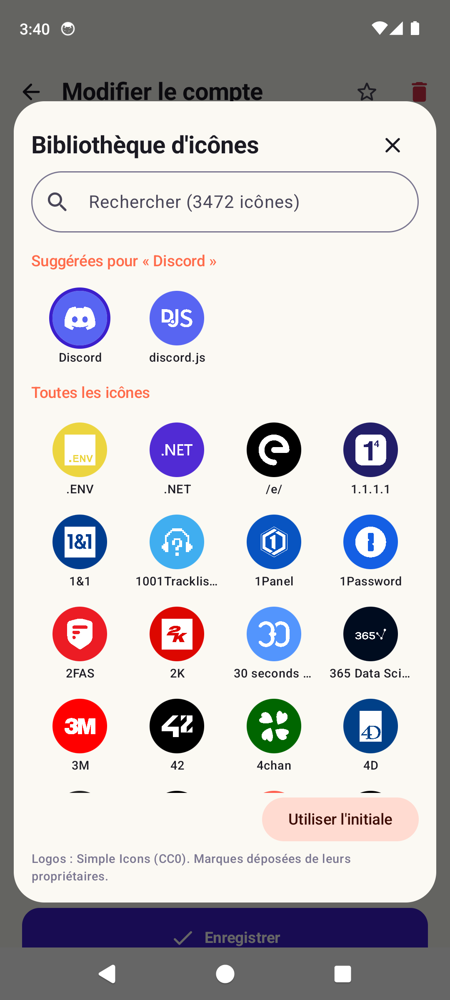
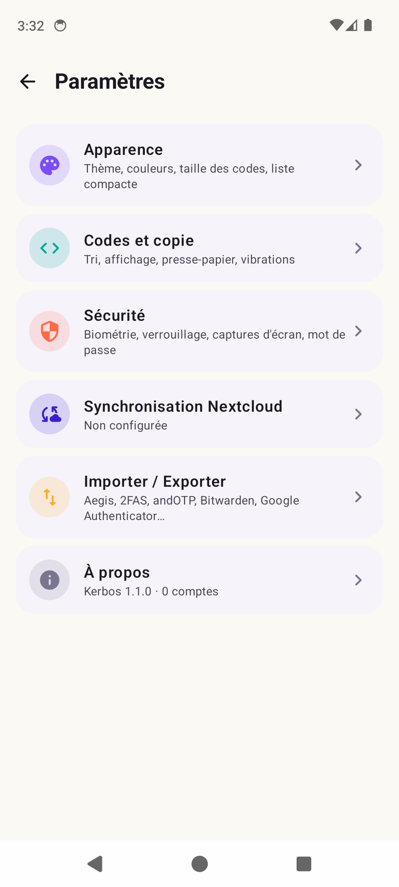
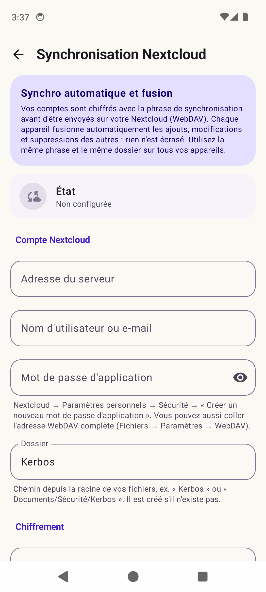
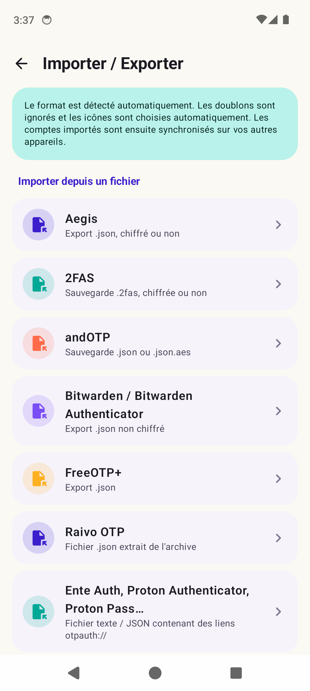

<p align="center"></p>

<h1 align="center">Kerbos</h1>

<p align="center">Authentificateur 2FA (TOTP / HOTP / Steam) pour Android, inspiré d'Aegis, avec <b>synchronisation automatique et fusion multi-appareils via votre propre Nextcloud</b>.</p>

<p align="center"><a href="https://github.com/0x80070006/kerbos/releases/latest">⬇️ Télécharger le dernier APK</a></p>

| Verrouillage | Accueil | Accueil (sombre) | Édition |
|:---:|:---:|:---:|:---:|
|  |  |  |  |
| **Icônes** | **Paramètres** | **Synchronisation** | **Import / export** |
|  |  |  |  |

## Fonctionnalités

- **Coffre chiffré** AES-256-GCM : clé maître aléatoire, déverrouillée par mot de passe (PBKDF2-SHA256, 210 000 itérations) et/ou biométrie forte (Android Keystore).
- **Biométrie par défaut** : l'invite s'ouvre automatiquement à chaque lancement. Rappel périodique du mot de passe pour ne pas l'oublier.
- **Ajout** par QR code (caméra), image / capture d'écran, saisie manuelle, liens `otpauth://`, exports Google Authenticator.
- **Bibliothèque de ~3 500 icônes** (Simple Icons, CC0) : l'icône de l'émetteur est choisie automatiquement et suggérée en premier.
- **Import** : Aegis (chiffré ou non), 2FAS (chiffré ou non), andOTP (chiffré ou non), Bitwarden / Bitwarden Authenticator, FreeOTP+, Raivo, Ente Auth / Proton (liens `otpauth://`), sauvegardes Kerbos. Détection automatique du format, doublons ignorés.
- **Export** : sauvegarde Kerbos chiffrée, Aegis chiffré ou non (réimportable dans Aegis), liste `otpauth://`, QR codes Google Authenticator.
- **Personnalisation** : thème clair / sombre / AMOLED, couleurs Material You, taille des codes, liste compacte, tri, code suivant, codes masqués, effacement du presse-papier, réduction après copie, vibrations, verrouillage automatique, blocage des captures d'écran.

## Synchronisation Nextcloud

Un seul fichier, `<dossier>/kerbos-vault.json`, sur votre Nextcloud. Il est **chiffré de bout en bout** avec une *phrase de synchronisation* commune à vos appareils : Nextcloud ne voit jamais vos secrets.

Fusion sans perte :
- chaque compte a un identifiant unique et un horodatage ; la modification la plus récente l'emporte, compte par compte ;
- les suppressions se propagent (pierres tombales conservées 180 jours) ;
- l'envoi est conditionné à l'ETag (`If-Match`) : si un autre appareil a écrit entre-temps, le cycle recommence, rien n'est écrasé.

Déclenchement : au déverrouillage, après chaque modification, périodiquement (30 s à 15 min) et au retour dans l'app. Option « Wi-Fi uniquement ».

Configuration : **Paramètres → Synchronisation Nextcloud** → adresse du serveur, identifiant (login ou e-mail), **mot de passe d'application** (Nextcloud → Paramètres personnels → Sécurité), dossier, phrase de synchronisation. L'identifiant interne du compte est obtenu automatiquement auprès du serveur (API OCS) ; le bouton **Tester** affiche un diagnostic détaillé. HTTPS obligatoire ; les autorités de certification installées par l'utilisateur sont acceptées.

## Compiler

Toolchain portable dans `.toolchain/` (JDK 17, SDK Android 34, Gradle 8.9) :

```bash
./build.sh testReleaseUnitTest assembleRelease
```

APK : `app/build/outputs/apk/release/app-release.apk`. Les tests unitaires couvrent scrypt (RFC 7914), TOTP (RFC 6238), les formats d'import / export et la fusion.

La signature utilise `keystore.properties` et `keystore/kerbos-release.jks` (hors dépôt).

## Licences

Icônes : [Simple Icons](https://simpleicons.org) (CC0) ; les logos restent des marques de leurs propriétaires.
